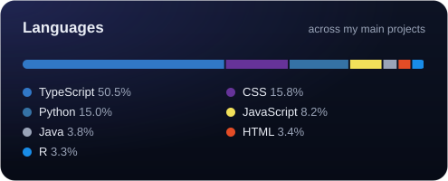
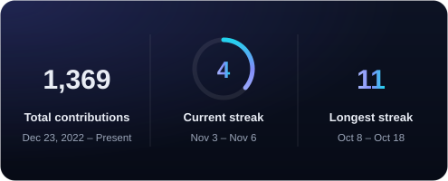

## Sabin Khanal

Software engineer in Kathmandu working across backend systems, APIs and machine learning. I build Python and TypeScript services, data pipelines and ML models, and I am open to **AI / ML software engineer** roles.

Currently at **Best Finance Company Ltd** (Transaction & Digital Banking team), building internal systems in Python, Flask and PostgreSQL and maintaining the Digital Lending System.

[Portfolio](https://sabinkhanal13.com.np) · [CV](https://sabinkhanal13.com.np/Sabin-Khanal-CV.pdf) · [LinkedIn](https://www.linkedin.com/in/sabin-khanal-950163326) · [Email](mailto:sabinkhanal13@gmail.com)

### Selected projects

| Project | What it shows |
| --- | --- |
| [house-price-ml](https://github.com/Sabin78910/house-price-ml) | Gradient-boosting regression in a scikit-learn pipeline, with a model card, checksummed artefacts, tests and CI |
| [khabar-pulse](https://github.com/Sabin78910/khabar-pulse) | News pipeline: RSS ingestion, cross-outlet deduplication, Devanagari-aware clustering and ranking |
| [private-pdf](https://github.com/Sabin78910/private-pdf) | On-device PDF tools with offline OCR (Nepali and English) and document-scanner image processing |
| [nepse-lens](https://github.com/Sabin78910/nepse-lens) | Nepal Stock Exchange data collector and analytics app |
| [sync-api](https://github.com/Sabin78910/sync-api) | End-to-end encrypted sync on Cloudflare Workers and Durable Objects |
| [concrete-strength-analysis](https://github.com/Sabin78910/concrete-strength-analysis) | R data-preparation pipeline: MICE imputation, outlier handling, scaling and PCA |

### Skills

- **Languages:** Python, TypeScript / JavaScript, PHP, R, SQL, Java, Kotlin
- **Backend and data:** Flask, FastAPI, Laravel, Pydantic, PostgreSQL, MySQL, Oracle Database and APEX
- **Machine learning:** scikit-learn, data preparation and feature engineering, model evaluation
- **Frontend:** React, Next.js, HTML, CSS, Bootstrap
- **Engineering:** Docker, Git, GitHub Actions, Linux, AWS, pytest, QA and UAT, Agile / Scrum

### Education

BSc (Hons) Computing, Leeds Beckett University ([The British College](https://www.thebritishcollege.edu.np/)), 2022 – 2025

### Activity

  
  

