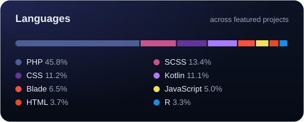
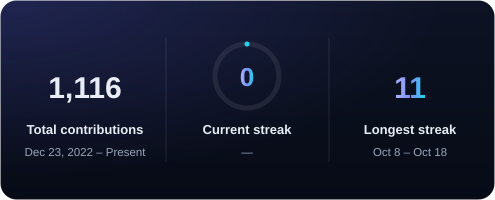

  <a href="https://sabinkhanal.com.np"><b>sabinkhanal.com.np</b></a> &nbsp;·&nbsp;
  <a href="https://www.linkedin.com/in/sabin-khanal-950163326">LinkedIn</a> &nbsp;·&nbsp;
  <a href="mailto:sabinkhanal13@gmail.com">sabinkhanal13@gmail.com</a>

---

### 👨‍💻 About Me

I'm a **Backend & Web Developer** at **Best Finance Company Ltd.** in Kathmandu, Nepal. I build the internal platforms a regulated finance company runs on (HR, correspondence and lending) with **Python, Flask, PostgreSQL and REST APIs**, and I test my own work before it ships.

- 🔭 **Working on:** Employee Appraisal System, Letter Management System and the Digital Lending System (Transaction & Digital Banking team)
- 🧪 **QA mindset:** functional, UAT and production testing. I write code thinking about how it could break
- 🛠️ **Stack:** Python, Flask, FastAPI, PostgreSQL, REST APIs, pytest, Docker, AWS
- 🎓 **Education:** BSc (Hons) Computing, Leeds Beckett University (UK), 2025
- 💼 **Open to:** software engineering and QA roles in backend, data and full-stack teams

---

### 🛠️ Tech Stack (hover for names)

  
  
  
  
  
  
  
  
   
  
  
  
  
  
  
  
   
  
  
  
  
  
  
  

Also: Pydantic · Oracle Database &amp; APEX · pytest · QA &amp; UAT · Agile / Scrum

---

### 🚀 Featured Work

  
  
  
  

---

### 📊 GitHub Stats

  
  

Updated daily by a GitHub Action in this repo. Languages are weighted across the featured projects above.

 

Correct before clever &nbsp;·&nbsp; Secure by default &nbsp;·&nbsp; Tested before shipped

