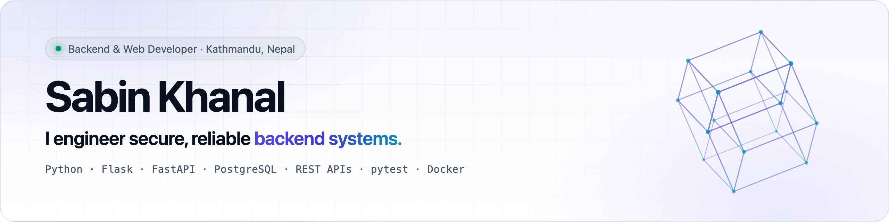

<picture>
  <source media="(prefers-color-scheme: dark)" srcset="assets/banner-dark.png">
  
</picture>

  
  
  

### About

I build the internal platforms a regulated finance company runs on (HR, correspondence and lending) at **Best Finance Company Ltd.**,
using **Python, Flask, PostgreSQL and REST APIs**, and I test my own work before it ships.
I started in QA, so I write code thinking about how it could break.

<table>
  <tr><td><b>Now</b></td><td>Transaction &amp; Digital Banking team, Best Finance Company (since Jun 2026)</td></tr>
  <tr><td><b>Building</b></td><td>Employee Appraisal System · Letter Management System · maintaining the Digital Lending System</td></tr>
  <tr><td><b>Education</b></td><td>BSc (Hons) Computing, Leeds Beckett University (UK), delivered at The British College, Kathmandu (2025)</td></tr>
  <tr><td><b>Open to</b></td><td>Software engineering and QA roles in backend, data and full-stack teams</td></tr>
</table>

### Tech stack

<table>
  <tr><td><b>Backend</b></td><td></td></tr>
  <tr><td><b>Data</b></td><td> &nbsp;+ Oracle Database &amp; APEX</td></tr>
  <tr><td><b>Frontend &amp; mobile</b></td><td></td></tr>
  <tr><td><b>Delivery</b></td><td> &nbsp;+ pytest · QA &amp; UAT · Agile/Scrum</td></tr>
</table>

### Featured projects

| Project | What it is | Built with |
|---|---|---|
| [**GrocerEase**](https://github.com/Sabin78910/GrocerEase) | Multi-vendor grocery marketplace: co-designed the Oracle schema, Oracle APEX dashboards, PayPal checkout and email OTP | PHP · Oracle · JavaScript |
| [**Concrete Compressive Strength**](https://github.com/Sabin78910/concrete-strength-analysis) | Data-preparation pipeline for machine learning: MICE imputation, IQR outliers, correlation analysis, Min–Max scaling, PCA | R · ggplot2 |
| [**Pet Marketplace**](https://github.com/Sabin78910/laravel-product-management) | Laravel REST API with a React + Redux Toolkit single-page app | Laravel · React · Redux |
| [**Android with Jetpack Compose**](https://github.com/Sabin78910/android-compose-projects) | Kotlin apps built with Jetpack Compose | Kotlin · Compose |

### How I work

**Correct before clever** · **Secure by default** · **Tested before shipped**

Kathmandu, Nepal · UTC+5:45

