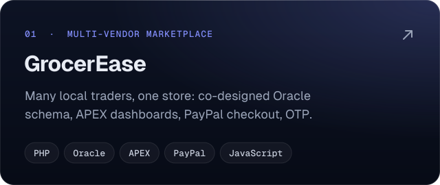
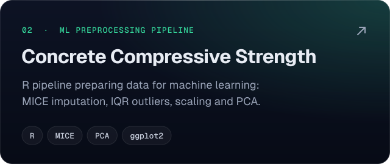
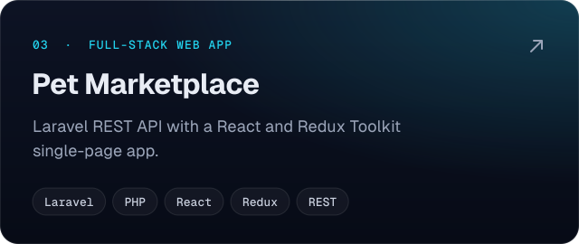
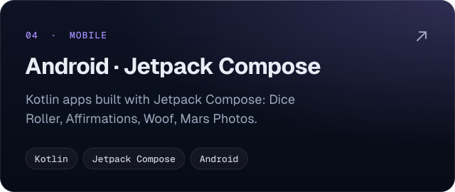

  <a href="https://sabinkhanal.com.np"><b>sabinkhanal.com.np</b></a> &nbsp;·&nbsp;
  <a href="https://www.linkedin.com/in/sabin-khanal-950163326">LinkedIn</a> &nbsp;·&nbsp;
  <a href="mailto:sabinkhanal13@gmail.com">sabinkhanal13@gmail.com</a>

 

I build the internal platforms a regulated finance company runs on (HR, correspondence and lending) at **Best Finance Company Ltd.** in Kathmandu, with **Python, Flask, PostgreSQL and REST APIs**. I started in QA, so I test my own work before it ships and write code thinking about how it could break.

- **Now:** Transaction & Digital Banking team. Employee Appraisal System, Letter Management System, and the Digital Lending System
- **Education:** BSc (Hons) Computing, Leeds Beckett University (UK), 2025
- **Open to:** software engineering and QA roles in backend, data and full-stack teams

### Featured work

  
  
  
  

### Stack

Also: Pydantic · Oracle Database & APEX · pytest · QA & UAT · Agile / Scrum

  

Correct before clever &nbsp;·&nbsp; Secure by default &nbsp;·&nbsp; Tested before shipped

